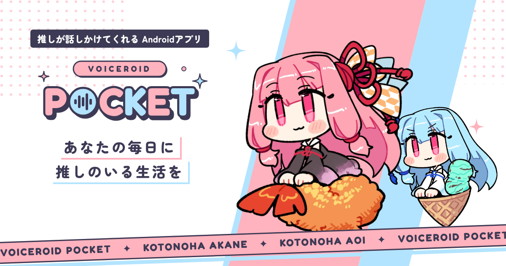

# VOICEROID POCKET 紹介ページ


琴葉 茜・琴葉 葵が、ホーム画面のウィジェット・アプリ画面・通知で話しかけてくれる Android アプリ「[VOICEROID POCKET](https://github.com/watagumo2000/PocketVOICEROID)」の紹介ページです。

**公開ページ：https://watagumo2000.github.io/PocketVOICEROID-web/**



---

## 🤖 このサイトは Claude が作りました

**このリポジトリのコードは、ほぼすべて Anthropic の AI「Claude」が書いています。**

作者（ﾜﾀｸﾞﾓ）が作りたいものを日本語で伝えました。それを受けて、[Claude Code](https://claude.com/claude-code)（Claude Opus 5.5）がコードを書き、動作確認をして、GitHub への公開まで行いました。デザインの見本とデザインシステムも、claude.ai の上で Claude と一緒に作ったものです（`design-ref/`）。
**自分は何もしてないのに自分の成果にするのは恥だと思ったのでREADMEにAI製であることを記します。**

### Claude がやったこと

- **技術選び**：Svelte 5＋Vite＋TypeScript＋Tailwind CSS v4 の構成を提案し、作者と相談して決めた
- **デザインの書き直し**：デザインの見本（Design Component 形式の `Top.dc.html`）を読み、Svelte の部品に分けて書き直した
- **デザインシステムの移し替え**：`tokens.json` の色・文字・余白・角丸・影を、Tailwind の `@theme` に移した。トークンにない色や大きさは使えないようにしてある
- **動き**：ふわふわ・キラキラ・流れるテープ・波形ロゴ・キャラの切り替えを作った。端末の「視差効果を減らす」設定では、すべての動きを止める
- **スマホ対応**：1920px から 360px まで7つの画面幅でスクリーンショットを撮って確かめ、重なりや詰まりを直した
- **自分で操作して確かめる**：ヘッドレスの Chromium を DevTools プロトコルで動かし、ナビの追従・メニュー・キャラの切り替え・横スクロールがないことを、実際に操作して確かめた
- **見つけて直したバグ**：
  - 見本の時点からあったもの：キラキラが4分の1しか表示されない、縦書きのコピーが白い帯の左に寄る
  - スマホで画面の幅が広がってしまう
- **公開まわり**：GitHub リポジトリの作成、GitHub Actions による自動公開、ファビコン、SNS 共有用の画像（OGP）、画像の軽量化（約 1.6MB → 約 380KB）
- **権利表記の確認**：キャラクター使用ガイドラインを読み、必要な著作権表記をフッターに入れた
- **コミット**：コミットメッセージもすべて Claude が書いている（`git log` を参照）

### 作者がやったこと

- 何を作るかと仕様を決める（ページの構成、載せる情報、やらないこと）
- 途中の判断（ヘッダーを固定する、ナビがスクロールに追従する、キャッチコピーの文言など）
- 見た目の確認とダメ出し（「ボタンを中央にして」「文字が左に寄ってるよ」など）
- アプリのスクリーンショット、茜のセリフ、リンク先などの用意

---

## 使っている技術

| | |
|---|---|
| フレームワーク | [Svelte 5](https://svelte.dev/)（runes）＋ [Vite 8](https://vite.dev/) |
| 言語 | TypeScript |
| CSS | [Tailwind CSS v4](https://tailwindcss.com/)（`src/app.css` の `@theme` にデザイントークン） |
| フォント | Google Fonts の Zen Maru Gothic（日本語）と Fredoka（英字） |
| 公開 | GitHub Pages（`main` に push すると GitHub Actions でビルドして公開） |

## 開発のしかた

```sh
npm install
npm run dev      # 開発サーバー（http://localhost:5173/PocketVOICEROID-web/）
npm run check    # 型チェック
npm run build    # dist/ にビルド
npm run preview  # ビルドしたものを手元で確認
```

## ファイルの場所

```
src/
├─ app.css                 デザイントークン（@theme）と、Tailwind にない書き方の独自ユーティリティ
├─ App.svelte              ページ全体の並び
└─ lib/
   ├─ data.ts              文言・キャラ・特徴・リンク先など、ページに出す内容はここにまとめてある
   ├─ ui.ts                ボタンやタグのクラスの組み合わせ、キャラ色の対応表
   ├─ components/          Header / Hero / Ribbon / Features / Characters / Situation / Voice / About / Footer など
   └─ images/              キャラのイラストとアプリのスクリーンショット（WebP）
public/                    ファビコン、SNS 共有用の画像（ogp.png）
tools/ogp.html             ogp.png の元。作り直す手順はファイルの先頭に書いてある
design-ref/                デザインの見本とデザインシステム（参考用で、ビルドには入らない）
```

### よくある変更

- **文言を変える**：たいていは `src/lib/data.ts` を書き換えればよい
- **スクリーンショットを差し替える**：`src/lib/images/screens/` の画像を置き換える。縦長で、幅 540px くらいの WebP がちょうどよい
- **色や余白を変える**：`src/app.css` の `@theme` を変える。`design-ref/tokens.json` とそろえておく
- **余白の数字**：`--spacing: 1px` にしてあるので、`p-18` は 18px、`gap-56` は 56px（トークンの `space-18`、`space-56` と同じ）

## 権利表記

- 「VOICEROID」は株式会社AHSの商標です。
- 琴葉茜 琴葉葵 (c) AI Inc.（[キャラクター使用ガイドライン](https://aivoice.jp/character/kotonoha/)）
- キャラクターのイラストは制作者から提供されたものです。
- フォント：Zen Maru Gothic、Fredoka（SIL Open Font License 1.1）

© ﾜﾀｸﾞﾓ
